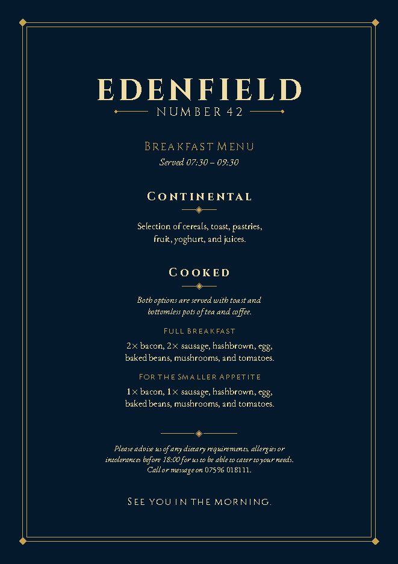
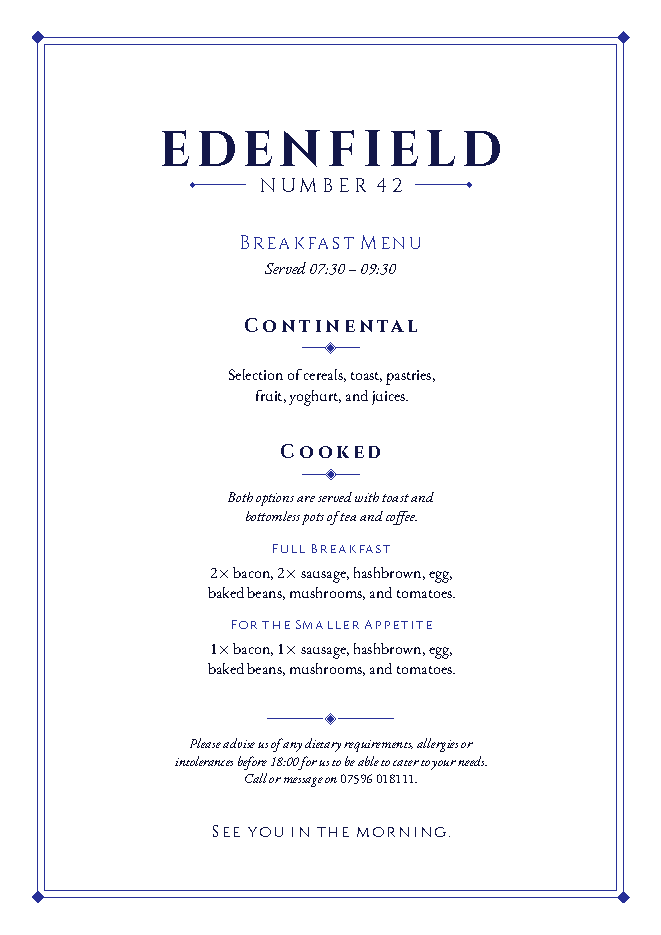
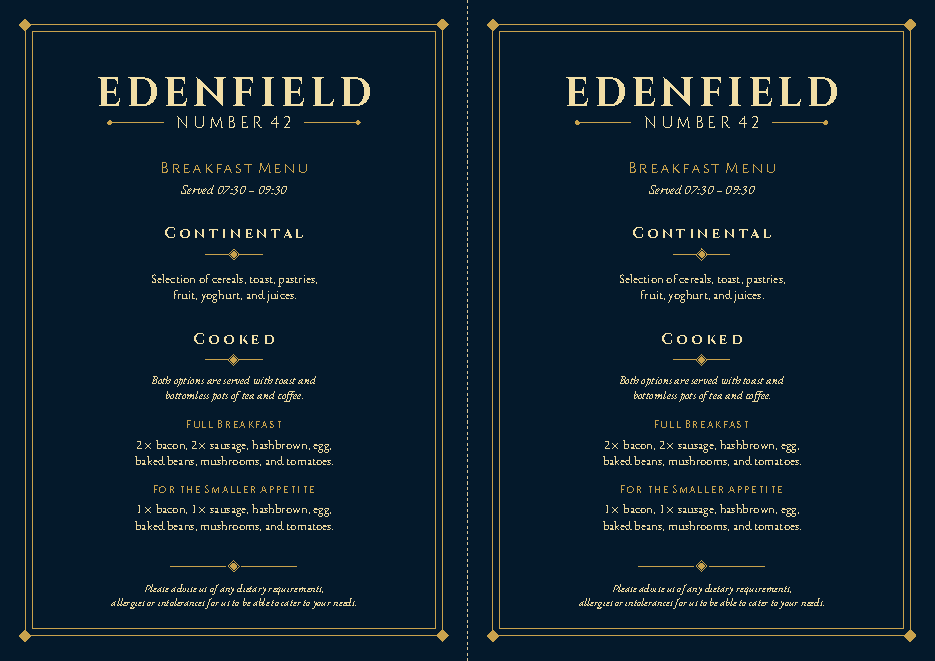

# Edenfield Number 42 — Breakfast Menus

Print-ready breakfast menus for Edenfield Number 42, typeset in LaTeX (LuaLaTeX).
Headings are set in **Cinzel** and body text in **EB Garamond**, with a double-rule
border and diamond ornaments throughout.

<p align="center">
  
  
  
</p>

## Formats

| Format | Page | Notes |
| --- | --- | --- |
| **Room menu** | A4 portrait | Full allergy wording with the 18:00 cut-off and contact number, plus the sign-off. |
| **Table menu** | A4 landscape | Two identical A5 cards with a cut line. Shorter allergy wording, no sign-off. |

## Colourways

| Name | File suffix | Use |
| --- | --- | --- |
| Navy | `_navy` | Gold on a full navy page (screen, or full-bleed printing) |
| Gold print | `_goldprint` | Gold only, no background — for printing on navy paper |
| Navy print | `_navyprint` | Navy ink on white paper |

Finished files are in [`pdf/`](pdf/), also bundled as `pdf/menus.zip`.

## Building

Requires a TeX distribution with **LuaLaTeX** (TeX Live / MacTeX) including the
`cinzel` and `ebgaramond` fonts.

```sh
./build.sh
```

This builds all six PDFs into `pdf/` and replaces `pdf/menus.zip`.

> The font paths in `edenfield.sty` point at a TeX Live 2026 install under
> `/usr/local/texlive/2026/`. Adjust them if your TeX tree lives elsewhere.

## Layout

```
edenfield.sty     shared style: fonts, colour themes, ornaments, menu text
room-menu.tex     A4 portrait layout
table-menu.tex    A4 landscape two-up layout (shorter allergy note, no sign-off)
build.sh          builds every format × colourway and zips the result
menumockups/      original Word drafts the design is based on
docs/             README previews
```

## Editing the menu

The wording lives in `\menubody` (and `\allergynote` / `\farewell`) in
`edenfield.sty`. The table menu overrides the allergy note and sign-off in
`table-menu.tex`. A single theme is selected at build time with
`lualatex "\def\theme{navy}\input{room-menu}"` (`navy`, `goldprint` or `navyprint`).
